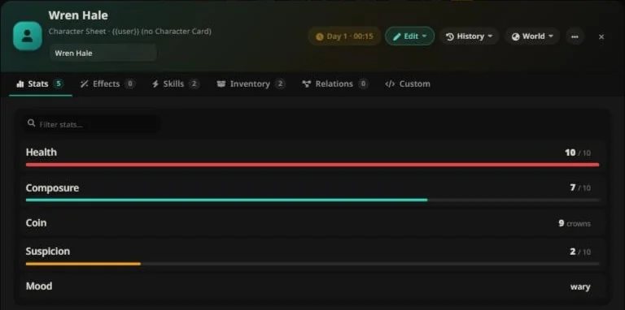

# Character State — Dynamic Character Sheets for SillyTavern

**Your characters remember. Your story keeps score.**

[🌐 English](README.md) | [🇻🇳 Tiếng Việt](README.vi.md) · [📖 Full Documentation (EN)](USER_GUIDE.md) · [📖 Tài liệu đầy đủ (VI)](USER_GUIDE.vi.md)

---

## What is this?

**Character State** turns SillyTavern characters into living game entities. Every character gets a persistent, evolving sheet — stats, skills, inventory, effects, relationships, an in-story clock — that the AI reads before every reply and updates automatically as the story unfolds. All the bookkeeping that roleplay normally loses between messages simply… stops being lost.

You play the story. The extension keeps the ledger.

## Why you want it

| Without | With Character State |
| --- | --- |
| "Wait, how much gold did I have?" | The sheet knows. So does the AI — every turn. |
| AI invents contradictory facts | AI reads the current truth before writing, and every change is logged |
| Status effects forgotten after 2 messages | Timed effects tick down and expire on their own |
| Re-rolling a scene loses all progress | Swipe or delete a message → state rolls back with it |
| Sheets are static lorebook text | Sheets are **alive** — values, graphs, progress bars, history |

## What it does

- **Living character sheets** — a game-style sheet (view / edit) for every character, side NPC, and even `{{user}}`, with number, boolean, choice and text fields, progress bars, groups and tabs.
- **AI-driven updates** — the AI receives the current state every turn and writes changes back using a strict, validated protocol. Wrong keys, impossible values, or over-reach are **rejected and taught back** to the model automatically.
- **Effects that actually expire** — buffs, poisons, charms: tick per turn or per in-game minute, stack, and clean themselves up.
- **An in-story clock** — the AI advances time; the extension tracks days, seasons and deadlines, and never invents time on its own.
- **Event cards in chat** — every change appears as a one-line card in the story flow (who changed, the biggest moves; click for every before → after) without costing a single token of AI context.
- **Full audit trail** — who changed what, when, before → after. Exportable. Plus graphs of any stat's history.
- **Snapshots & rollback** — automatic restore points; swipes and message deletions roll the world back with the story.
- **Side NPCs, scenes, user sheet, relationships** — the whole cast and world get state, created on your explicit order only.
- **AI sheet designer (optional)** — flip one switch and the AI can draft an entire character sheet for you, chat-scoped, with the card untouched until *you* decide to adopt it.

<em>An event card in chat: every applied change shows up in the story flow.</em>

## Design principles

- **Fully dynamic — not an RPG module.** Nothing in the engine knows what "HP" or "gold" means. Dating sims, survival, business sims, fantasy adventures — the schema comes from your data, not our assumptions.
- **Works with every model.** A text protocol any LLM can follow; native tool calling is used automatically when the model supports it, with a text fallback when it doesn't.
- **The AI has exactly as much power as you give it.** Base values stay locked unless you unlock them. Creating or deleting characters, redesigning sheets, touching your private notes — all gated behind explicit user actions.
- **Everything is local and per-chat.** States live in the chat; cards hold only the defaults you choose to save. Nothing leaves your machine.

## Highlights

- 🔒 **Safety net** — every message is journaled; swipes restore world state; automatic snapshots every N messages.
- 🩹 **Self-healing protocol** — truncated output, malformed JSON, hallucinated tags, forgotten closing tags: recovered, repaired, or rejected with a lesson for the model — never silently applied.
- 🧠 **Token-smart** — compact state views, lazy group summaries, lean on-demand reads. Big sheets stay affordable.
- 📱 **Clean on desktop and phone** — tabbed sheet, a six-button header, stat filter, tap-for-details rows, full-screen on phones, Esc to close, English / Tiếng Việt interface.
- 🧭 **Play-friendly** — quick ± adjust and ★ pins with a HUD above the chat input, a relations tab, a real clock editor (day/hour, sleep, pause, calendar), one History screen, configuration export/import, and a *Maximum* prompt mode for the smartest AI.
- 🎛 **Yours to shape** — built-in presets for 10 genres (fantasy, system, cultivation, survival, romance…), your own presets, reusable components, per-field copy/paste across characters, custom display modes, hidden fields.

## Compatibility

- SillyTavern **1.18.0+**
- Any chat completion source. Native tool calling is detected automatically (optional but nicer).
- Single chat, group chats, and your existing characters — no card format changes required.

## Installation

**Requirements:** SillyTavern **1.18.0+**. Works with any chat completion source; native tool calling is used automatically when the model supports it.

**Option 1 — install from SillyTavern (recommended):**

1. Open the **Extensions** panel (puzzle icon) → click **Install extension**.
2. Paste the Git URL: `https://github.com/khangdh0202/SillyTavern-CharacterStats`
3. Pick **Install just for me** (this user profile) or **Install for all users** (shared across accounts on this SillyTavern install).
4. Open any chat — a **sheet button** appears above the message input box. Done: the AI reads the state every turn and keeps it updated.

**Option 2 — manual:**

Clone or copy the repository into an extensions folder, then reload SillyTavern (F5):

- Per user: `data/<user-handle>/extensions/character-state`
- All users: `public/scripts/extensions/third-party/character-state`

**Updating to a new version:** open the Extensions panel → **Manage extensions** → *Update* next to the extension (or `git pull` inside the extension folder), then reload the page (F5). All state lives in your chat save files — an update never touches it.

**No sheet yet on your character?** Two ways to get one:

- Build it yourself: open the sheet, choose **Edit ▸ Edit the card defaults (new chats)**, add stats, save.
- Let the AI draft it: enable *"ARM: let the AI design a sheet once"* in ⚙ Settings, ask the AI in chat, review the result, choose **⋯ ▸ Save this chat as the card defaults…** when happy (see the guide, section *AI Sheet Designer*).

**Troubleshoot:** if the button doesn't appear — check the browser console (F12) for `Character State` messages, confirm `manifest.json` sits directly inside the extension folder (any folder name works), and confirm the extension is listed in the Extensions panel.

## Part of a suite

Works on its own, and also plugs into these companion extensions by the same author:

| Extension | What it adds |
|---|---|
| [Storyline](https://github.com/khangdh0202/SillyTavern-Storyline) | Storyteller chat mode: you play the main character, the AI narrates the world |
| [Dice Weaver](https://github.com/khangdh0202/SillyTavern-DiceWeaver) | Real d20 rolls the AI triggers |
| [Memory Weaver](https://github.com/khangdh0202/SillyTavern-MemoryWeaver) | Long-term story memory |

## Documentation

📖 **[USER_GUIDE.md](USER_GUIDE.md)** — the full manual: every feature, every setting, step by step.
🇻🇳 **[USER_GUIDE.vi.md](USER_GUIDE.vi.md)** — tài liệu đầy đủ bằng tiếng Việt.

## 🐞 Bug reports & help

Found a bug or have a question? Open an issue on **[GitHub Issues](https://github.com/khangdh0202/SillyTavern-CharacterStats/issues/new/choose)** and pick *Bug report* or *Question / idea* — the form asks for everything needed.

A good bug report includes:

- your SillyTavern version and Character State version (Extensions panel → Manage extensions)
- the API / model you use
- steps to reproduce: what you did, what you expected, what happened instead
- errors from the browser console (F12 → Console), if any — copy the red lines
- a screenshot when something looks wrong

Remove private story content and API keys before posting — issues are public.

## ❤️ Support

If Character State makes your stories better, consider supporting the project:

or click the **💜 Sponsor** button at the top of this repository (enabled via `.github/FUNDING.yml`).

## License

Released under the [GNU General Public License v3.0 (GPL-3.0)](LICENSE) — free to use, modify and redistribute; any fork or redistribution must stay open-source under the same license. © 2026 kdturtle.
