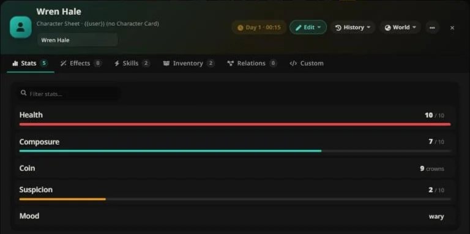

# Character State — Bảng trạng thái nhân vật động cho SillyTavern

**Nhân vật của bạn biết nhớ. Câu chuyện của bạn tự ghi điểm.**

[🌐 English](README.md) | [🇻🇳 Tiếng Việt](README.vi.md) · [📖 Tài liệu đầy đủ (VI)](USER_GUIDE.vi.md) · [📖 Full Documentation (EN)](USER_GUIDE.md)

---

## Đây là gì?

**Character State** biến nhân vật SillyTavern thành thực thể "sống" như trong game. Mỗi nhân vật có một bảng trạng thái (sheet) bền vững và tiến triển theo truyện — stats, kỹ năng, đồ đạc, hiệu ứng, quan hệ nhân vật, đồng hồ trong game — mà AI **đọc trước mỗi lượt trả lời** và **tự cập nhật** khi câu chuyện diễn ra. Mọi con số mà roleplay thường xuyên "mất" giữa các tin nhắn từ nay không còn mất nữa.

Bạn chơi truyện. Extension lo phần sổ sách.

## Vì sao bạn cần nó

| Không có | Có Character State |
| --- | --- |
| "Ủa lúc trước mình có bao nhiêu tiền nhỉ?" | Sheet biết. AI cũng biết — mỗi lượt. |
| AI tự bịa mâu thuẫn với trước | AI đọc trạng thái hiện tại trước khi viết, mọi thay đổi đều được ghi log |
| Hiệu ứng trạng thái quên sau 2 tin nhắn | Hiệu ứng có thời hạn tự đếm và tự hết hạn |
| Reroll một cảnh = mất hết tiến trình | Swipe hoặc xoá tin nhắn → trạng thái quay lại theo |
| Sheet chỉ là đoạn text tĩnh trong lorebook | Sheet **sống** — giá trị, đồ thị, progress bar, lịch sử |

## Nó làm được gì

- **Sheet nhân vật sống** — giao diện kiểu game (xem / sửa) cho mọi nhân vật, side NPC, kể cả `{{user}}`: number, boolean, choice, text, progress bar, nhóm và tab.
- **AI tự cập nhật** — AI nhận trạng thái hiện tại mỗi lượt và ghi thay đổi qua protocol nghiêm ngặt có kiểm tra. Key sai, giá trị phi lý, vượt quyền → **bị chặn và được "dạy lại"** tự động.
- **Hiệu ứng thật sự hết hạn** — buff, độc, mê hoặc: đếm theo lượt hoặc theo phút trong game, có stacking, tự dọn dẹp.
- **Đồng hồ trong game** — AI kéo thời gian; extension tính ngày, mùa, deadline, và không bao giờ tự bịa mốc thời gian.
- **Thẻ sự kiện trong chat** — mỗi thay đổi hiện thành thẻ một dòng trong dòng truyện (ai thay đổi, thay đổi lớn nhất; bấm để xem mọi before → after) mà **không tốn một token context nào** của AI.
- **Nhật ký đầy đủ** — ai đổi gì, khi nào, từ đâu → thành đâu. Xuất được JSON/CSV. Kèm đồ thị lịch sử từng stat.
- **Snapshot & rollback** — điểm khôi phục tự động; swipe/xoá tin nhắn thì cả thế giới quay lại theo truyện.
- **Side NPC, scene, sheet cho user, quan hệ nhân vật** — cả dàn diễn viên và thế giới đều có trạng thái, và chỉ được tạo khi **bạn ra lệnh**.
- **AI tự thiết kế sheet (tuỳ chọn)** — bật 1 công tắc, AI có thể soạn cả bộ sheet cho bạn, chỉ áp trong chat này, card không bị đụng tới cho đến khi **bạn** quyết định nhận.

<em>Thẻ sự kiện trong chat: mọi thay đổi được áp dụng đều hiện ngay trong mạch truyện.</em>

## Triết lý thiết kế

- **Hoàn toàn động — không phải module RPG đóng gói.** Không một dòng engine nào biết "HP" hay "vàng" nghĩa là gì. Dating sim, survival, kinh doanh, phiêu lưu fantasy — cấu trúc sheet đến từ data của bạn, không phải giả định của chúng tôi.
- **Chạy với mọi model.** Protocol dạng text mà LLM nào cũng làm theo; khi model hỗ trợ tool calling thì tự dùng tool (đẹp hơn), không hỗ trợ thì tự fallback về text.
- **AI có đúng quyền bạn cho.** Base khóa mặc định, chìa khóa do bạn cầm. Tạo/xoá nhân vật, thiết kế lại sheet, đụng ghi chú riêng của bạn — tất cả đều phải qua hành động rõ ràng của user.
- **Mọi thứ local và theo chat.** Trạng thái nằm trong chat; card chỉ giữ defaults bạn chọn lưu. Không có gì rời khỏi máy bạn.

## Điểm nổi bật

- 🔒 **Lưới an toàn** — mỗi tin nhắn được journal; swipe khôi phục thế giới; snapshot tự động mỗi N tin nhắn.
- 🩹 **Protocol tự chữa lành** — output bị cắt, JSON hỏng, tag bịa lung tung, thiếu tag đóng: được cứu, sửa, hoặc chặn kèm "bài học" cho model — không bao giờ âm thầm áp bừa.
- 🧠 **Tiết kiệm token** — chế độ xem state gọn, tóm tắt lười cho group, đọc sâu theo yêu cầu. Sheet lớn vẫn rẻ.
- 📱 **Gọn trên máy tính lẫn điện thoại** — sheet chia tab, header sáu nút, ô lọc chỉ số, chạm để xem chi tiết, toàn màn hình trên điện thoại, Esc để đóng, giao diện English / Tiếng Việt.
- 🧭 **Tiện khi chơi** — chỉnh nhanh ±, ★ ghim chỉ số kèm HUD phía trên ô chat, tab quan hệ, hộp chỉnh đồng hồ thật (ngày/giờ, ngủ, tạm dừng, lịch), một màn Lịch sử, xuất/nhập cấu hình, và chế độ prompt *Tối đa* để AI hiểu nhiều nhất.
- 🎛 **Theo ý bạn** — presets, component tái sử dụng, copy/paste từng field giữa các nhân vật, chế độ hiển thị custom, ẩn field khỏi prompt.

## Tương thích

- SillyTavern **1.18.0+**
- Mọi nguồn chat completion. Tool calling tự động được nhận diện (tuỳ chọn, có thì trải nghiệm đẹp hơn).
- Chat đơn, group chat, các card có sẵn — không cần đổi format card.

## Cài đặt

**Yêu cầu:** SillyTavern **1.18.0+**. Chạy với mọi nguồn chat completion; tool calling tự động được dùng khi model hỗ trợ.

**Cách 1 — cài thẳng từ SillyTavern (khuyên dùng):**

1. Mở panel **Extensions** (icon puzzle) → bấm **Install extension**.
2. Dán Git URL: `https://github.com/khangdh0202/SillyTavern-CharacterStats`
3. Chọn **Install just for me** (cho riêng user này) hoặc **Install for all users** (dùng chung mọi tài khoản trên bản ST này).
4. Mở bất kỳ chat nào — **nút sheet** hiện ra phía trên ô nhập tin. Xong: AI đọc trạng thái mỗi lượt và tự cập nhật.

**Cách 2 — thủ công:**

Clone hoặc copy repo vào một trong hai thư mục extensions rồi reload SillyTavern (F5):

- Theo user: `data/<user-handle>/extensions/character-state`
- Dùng chung: `public/scripts/extensions/third-party/character-state`

**Nâng cấp phiên bản mới:** panel **Extensions** → **Manage extensions** → *Update* ở extension (hoặc `git pull` trong thư mục extension), rồi reload trang (F5). Toàn bộ state nằm trong file lưu chat — update không bao giờ đụng vào.

**Chưa có sheet cho nhân vật?** Hai cách:

- Tự dựng: mở sheet, chọn **Sửa ▸ Sửa mặc định của card (chat mới)**, thêm stats, save.
- Để AI soạn: bật *"ARM: let the AI design a sheet once"* trong ⚙ Settings, yêu cầu AI trong chat, xem kết quả, ưng thì chọn **⋯ ▸ Ghi chat này thành mặc định của card…** (xem guide, mục *AI Sheet Designer*).

**Xử lý sự cố:** nút không hiện — xem console trình duyệt (F12) có log `Character State` không, kiểm tra `manifest.json` nằm ngay trong thư mục extension (tên thư mục nào cũng được), và kiểm tra extension có xuất hiện trong panel Extensions.

## Thuộc một bộ extension

Chạy độc lập được, và kết hợp được với các extension cùng tác giả:

| Extension | Thêm gì |
|---|---|
| [Storyline](https://github.com/khangdh0202/SillyTavern-Storyline) | Chế độ chat người kể chuyện: bạn nhập vai nhân vật chính, AI kể cả thế giới |
| [Dice Weaver](https://github.com/khangdh0202/SillyTavern-DiceWeaver) | Xúc xắc d20 thật do AI kích hoạt |
| [Memory Weaver](https://github.com/khangdh0202/SillyTavern-MemoryWeaver) | Bộ nhớ truyện dài hạn |

## Tài liệu

📖 **[USER_GUIDE.vi.md](USER_GUIDE.vi.md)** — hướng dẫn đầy đủ tiếng Việt: mọi tính năng, mọi setting, từng bước.
🌐 **[USER_GUIDE.md](USER_GUIDE.md)** — full manual in English.

## 🐞 Báo lỗi & hỗ trợ

Gặp lỗi hoặc có câu hỏi? Mở issue tại **[GitHub Issues](https://github.com/khangdh0202/SillyTavern-CharacterStats/issues/new/choose)** và chọn *Bug report* hoặc *Question / idea* — form sẽ hỏi đủ thông tin cần thiết.

Một báo lỗi tốt gồm:

- phiên bản SillyTavern và phiên bản Character State (panel Extensions → Manage extensions)
- API / model bạn đang dùng
- các bước tái hiện: bạn đã làm gì, mong đợi gì, thực tế xảy ra gì
- lỗi trong console trình duyệt (F12 → Console) nếu có — copy các dòng màu đỏ
- ảnh chụp màn hình khi hiển thị sai

Hãy xoá nội dung truyện riêng tư và API key trước khi đăng — issue là công khai.

## ❤️ Ủng hộ

Nếu Character State làm câu chuyện của bạn hay hơn, hãy cân nhắc ủng hộ:

hoặc bấm nút **💜 Sponsor** ở đầu trang repo (bật qua `.github/FUNDING.yml`).

## License

Phát hành theo [GNU General Public License v3.0 (GPL-3.0)](LICENSE) — tự do dùng, sửa, phân phối; mọi bản fork/phân phối phải mở source theo cùng license. © 2026 kdturtle.
